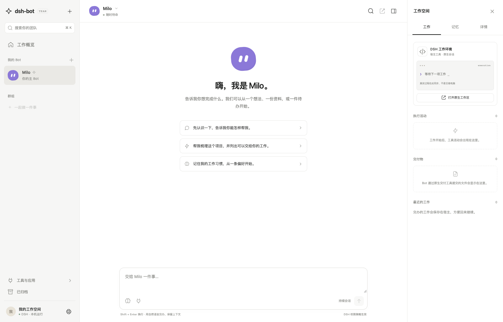

# dsh-bot · AI 同事团队

**Persistent AI teammates for DeepSeek Harness.**

[下载安装包](https://github.com/ZYX121212/dsh-bot/releases/tag/v0.5.1) · [反馈问题](https://github.com/ZYX121212/dsh-bot/issues) · [参与贡献](CONTRIBUTING.md) · [MIT License](LICENSE)



> 预览为实际构建组件在自动化测试载体中的截图，不是真实模型端到端演示；详见[截图说明](docs/screenshots/README.md)。当前为早期版本，欢迎反馈。

参考 [Grok Bot](https://x.ai/bot) 的**长期 AI 同事 / 团队协作**产品形式，为 DeepSeek Harness 构建的原生双端插件。不是 X 上的自动回复账号，也不是套了四种提示词的单轮问答页。独立 dsh-bot 品牌，非 Grok/xAI 官方产品。

## 0.5.1 · RPC 协议修复（公开预览）

本分支为 **0.5.1 公开预览**，安装包与更新说明见 [v0.5.1 Release](https://github.com/ZYX121212/dsh-bot/releases/tag/v0.5.1)。修复 0.5.0 工作区读写请求缺少 `{ args: ... }` 封套、实际宿主报 `Remote payload must contain exactly one plain-object args field` 的问题；旧版不建议继续安装。没有迁移或清空用户数据。

347 项单元 / 契约测试包含实际 SDK Gateway、Connection Fetch 载体、Owner / Guest 权限及磁盘写入回归；147 项构建组件回归的元数据路径也经真实 Gateway 和构建后的 Host 服务，不再用直接读写存储的替身冒充协议校验。原生会话、模型、工具和审批仍为明确的测试替身，尚未完成已认证桌面与真实模型端到端验收，不将此预览版标为生产稳定版。

- **完整检索与导出**：对话搜索与 Markdown 导出会继续读取原生更早事件页，包括没有公开聊天文本的工具页；以原生当前公开消息为准，不复活失败尝试或被替换的消息。读取失败可重试，不把部分历史冒充完整文件；关闭导出或切换会话不会产生迟到下载。
- **保存闭环**：Bot、群组、记忆保存期间锁定表单与关闭操作；防止重复提交和提交后编辑被丢弃。失败保留原值，可修改后重试。
- **明确路由**：长名字优先完整匹配；同名歧义、未知目标或失效目标会在创建任务前拒绝。代码块、行内代码和邮箱中的 @ 不会意外分派工作。
- **归档与恢复**：归档对话只读，不创建新任务；已有工作不因此取消。群组可以只有一位成员；已选的归档成员仍可看到并移除。创建成功会退出归档筛选，展示实际新记录。
- **可控整理**：设置可确认清空当前群聊记录、清理已结束的任务与运行记录；归档实体可确认删除。未结束的工作和未同步的原生结果受保护，原生会话不被这些元数据操作删除。
- **结果归属与恢复**：唯一交办标识匹配实际公开用户帧和原生轮次，不用任意较新的完成事件替别人结案。实际结果先保存，再幂等写入群聊与任务状态；暂时的存储失败保留结果并重试，不重发原生工作。旧记录缺少归属证明时保持待核实。

- **统一配色**：雾白 / 石墨灰表面配低饱和紫色主调；文字、图标、选中、输入、悬停、禁用和错误状态共用语义色令牌。保留 Bot 自己的球体颜色。正文与辅助文字的令牌组合按 4.5:1、焦点与输入边界按 3:1 验证；实际组件另在五种外观 / 系统组合中检查，不以此冒称完整 WCAG 认证。

- **简洁界面**：只保留名称、状态、内容和操作。移除口号、英文装饰标签、说明段落、重复提示与空占位区块。工作侧栏默认收起，可记住本机选择。
- **消息阅读**：助手回复支持安全的小型 Markdown 子集，包括标题、列表、引用、行内代码、链接与可复制代码块；不执行 HTML，不加载消息中的外部图片。
- **阅读位置**：阅读历史时新回复不会强制滚到底部；可一键回到最新消息。更早消息加载时保留视口位置。
- **搜索与输入**：团队搜索和对话搜索互不干扰；支持输入法确认、多行输入与独立草稿。消息获得实际原生接收回执后才清理提交版本，发送期间的新编辑不会被覆盖。
- **状态可靠性**：取消失败不会被记成成功取消；恢复追踪的持久化失败可重试；元数据读取失败不冒充原生会话离线；消息准备期间原生基线发生变化时不会误用别人的完成事件。


- **统一球形角色**：所有 Bot 都显示为圆球，不再提供方形、菱形或六边形选项；旧形状数据仍可读取，但渲染统一为球形。
- **简洁圆球**：只有柔和球面明暗与球内的眼睛、嘴巴。没有天线、小手、面罩边框、外露工具、星星或外围光效；所有可见图形统一裁剪在球体边界内，群组角色也不额外叠球。
- **轻量立体感**：以柔和径向明暗表达球面，不使用夸张金属高光或复杂面板。是 SVG / CSS 的 **2.5D 体积表现**，不是 WebGL 模型或完整三维场景。
- **真实状态表情**：待命时呼吸眨眼；真实思考、检索、动手、回复、等待处理、完成与出错分别对应不同神情和动作。角色没有自主意识，待命小动作不代表在执行工作。
- **多 Bot 动态工作台**：实际创建的团队成员才会出现在卡片里。名册、聊天标题与工作侧栏同步各自状态；没有内置假团队或假任务。
- **动画可控**：设置中可暂停角色动作；尊重系统减少动画偏好；页面隐藏时暂停，历史消息头像静止。暂停动画不会取消任务。
- **有限观察**：最多 8 个额外的被动会话观察订阅（不包括任务自身的追踪），优先选中与活跃成员；其余使用已在追踪的任务快照或原生状态提示。为保护已经运行的工作，原生运行时可能把底层绑定保留到本轮结束。只观察，不创建、发送或重放任务；未读取到的状态不会冒充正在工作。
- **团队名册**：创建和编辑不同名字、颜色、职责的 Bot；指定主 Bot；归档与恢复。
- **持续对话**：每位 Bot 关联并复用一个原生 DSH 会话，不按每条消息重新创建。上下文、工具执行和模型选择由 DSH 承载。
- **真实工作**：新 Bot 使用宿主 `standard` 工具预设，不再使用 v0.1 的只读问答预设。代码、文件、搜索、技能、MCP 等，以宿主实际暴露和授权的能力为准。
- **群组协作**：把真实 Bot 加入群组。`@Scout` 指定负责人；`@everyone` 按成员顺序交办，后者获得前面的群组回复。每位成员使用自己的持续会话，回复保存真实作者和会话关联。群聊记录保留本轮公开回复的末尾最多 16000 字符；完整回复仍在对应成员的原生会话中。
- **明确的记忆**：手动添加、编辑、删除私人或团队共享记忆；每次交办实际注入对应 Bot 的职责、记忆和必要群组上下文。不是演示数据，不宣称自动学习。
- **可观察的工作**：工具活动、执行状态、待处理交互、原生文件交付事件、历史工作记录。
- **原生授权入口**：遇到审批或人工输入时，跳转真实 DSH 会话处理。插件不暗中同意请求，不改变权限策略。
- **可收起工作侧栏**：左侧名册和群组，中间持续对话；工作 / 记忆 / 详情按需打开。支持浅色、深色、系统主题和移动抽屉。
- **宿主持久化**：名册、群组、显式记忆和任务/运行记录由宿主文件存储，跨页面刷新；对话保存在原生会话。
- **恢复追踪**：记录原生事件基线，刷新后重新观察已提交的运行，不重发任务。页面中断后的群组只恢复已观察到的成员结果，不擅自重放后续成员。

首次使用是空工作空间：不会预置看似正在工作的假 Bot、聊天或任务。模板只填充新建表单，不调用模型。

## 与 Grok Bot 的边界

| 能力 | 本版实际实现 |
| --- | --- |
| 多 Bot 身份、主 Bot、各自职责 | 已实现，宿主保存 |
| 私聊与群组 | 已实现；群组为插件层显式路由，不冒充 DSH 原生 Lead/Team RPC |
| 长期记忆 | 显式私人 / 共享记忆；不自动挖掘，不是向量记忆系统 |
| 工具和实际执行 | 宿主原生 standard 会话；不是独立 provider 请求 |
| 应用连接 | 复用已配置的 DSH 工具/MCP；没有虚构 Gmail、Slack 等一键连接器 |
| 工作现场 | 真实工具活动、状态、原生交付文件；不是远程桌面串流 |
| 审批 | 检测原生 pending interaction，跳转宿主处理；不提供替代审批决策 |
| 云电脑、每 Bot 独立桌面 | **未实现**，需要另行接入实际执行基础设施 |
| 应用退出、电脑关机后继续运行 | **不保证**；本地 DSH 宿主必须保持运行 |
| 自动定时日程、跨平台收发消息 | **未实现**；不会在安装或模板点击时偷偷创建计划任务 |
| 无人介入的长期 Bot 间自治对话 | **未实现**；群组由用户交办和 @ 路由推进 |

Bot 可以使用宿主实际允许的子代理工具，但这些临时子代理不等于产品名册里的持久 Bot。模型仍可能出错，重要交付需检查。

## 安装与升级

针对 **DSH 0.2.2-rc.1 / Node >=24.9.0**。其他版本需要实际验证，不建议使用版本豁免强装。

**普通用户**：到 [GitHub Releases](https://github.com/ZYX121212/dsh-bot/releases/tag/v0.5.1) 下载 tgz 安装包，或在应用内插件管理器使用下方发行包地址安装。目前未发布 npm；市场是否可搜索，以实际目录收录和同步结果为准。

**开发者从源码构建**：

```bash
git clone https://github.com/ZYX121212/dsh-bot.git
cd dsh-bot
npm ci --ignore-scripts
npm run check
npx playwright install chromium
npm run test:browser
npm pack --pack-destination artifacts
```

构建使用开发依赖 esbuild；React 由 DSH 提供，不打包第二份 React/Cordis。宿主 SDK 是匹配版本的 peer dependencies。

推荐安装已构建的 tgz bundle，以让包管理器正确处理 SDK peers：

```text
dsh plugin --profile web add https://github.com/ZYX121212/dsh-bot/releases/download/v0.5.1/dsh-bot-0.5.1.tgz
```

桌面版优先通过应用内插件管理器安装以上 URL；命令示例中的 `web` 仅适用于该 profile，其他安装方式请替换成实际 profile。也可下载后使用 DSH 插件管理器的 `install_bundle` 安装本地绝对路径。不要启动另一套 Web 服务来代替当前 GUI。

**升级后重启 DeepSeek Harness 应用**，从侧边栏打开 **dsh-bot**。仅刷新网页不足以确保旧宿主模块卸载。运行桌面发行版时没有源码 watcher，不承诺保存源文件就热更新。

旧的 `dsh-bot` 只读预设保留为 **v1 兼容项**，用于恢复以前的原生问答会话。0.2 新建同事固定使用 `standard`；不会偷偷迁移或提升旧会话的权限。v1 浏览器问答记录不自动变成新团队对话。

## 开始使用

1. 创建主 Bot：选一个模板，或自定义名字、职责和头像。
2. 交办一件具体工作，例如“先检查当前项目，列出结构，再帮我完成一个有测试的改动”。会消耗你在 DSH 中配置的模型额度。
3. Bot 首次开始时建立原生会话，并尽可能继承当前**原生主会话**工作目录；未能明确识别时使用 DSH 默认目录，不猜测最近文件夹。
4. 查看右侧真实工具活动和交付物。“打开原生工作区”会进入该 Bot 的 DSH 会话，可查看完整工具详情、处理授权、打开文件。
5. 添加研究、写作等专长 Bot；至少一位有效成员时可以新建群组。
6. 在群里 `@Scout 核查资料`，或 `@everyone 分别检查这份方案`。无 @ 时交给群内主 Bot，否则交给第一位有效成员。
7. 把长期偏好保存到“记忆”，选择仅该 Bot 或全部共享。职责和记忆应用于**下一次交办**，不回溯删除原生会话里已存在的内容。

支持 Enter 发送、Shift + Enter 换行、中文输入法、⌘/Ctrl K 搜索团队、⌘/Ctrl N 新建 Bot、Escape 关闭弹窗、键盘焦点循环。工作中可以编辑下一条草稿；需要中途人工交互时进入原生会话。

### 停止与页面生命周期

- 明确点击停止，才请求取消。已跟踪的排队交办通过唯一标识找到实际队列项并移除；正在执行的交办只取消已确认属于本次的原生轮次，不误停别人的当前工作。归属尚未确认时保留真实追踪状态，不把通用回执冒充已取消。群组同时阻止尚未开始的后续成员。
- 切换 Bot、切出工作台、关闭面板不会自动取消宿主任务。
- 插件卸载或浏览器关闭会中断**客户端的群组编排与实时追踪**。已开始的原生任务是否继续，由仍运行的 DSH 宿主决定。
- 重开后重新观察持久运行；不把“已提交”当作“已完成”，也不为恢复页面而自动重发有副作用的工作。
- 单次连续追踪 60 分钟后提示人工检查，不因此自动取消宿主工作。尚未观察到本次原生边界的旧记录保持待处理，不猜测成功。
- 群组消息上限为 400 条；已知剩余位置不足时在交办前拒绝，不暗中裁掉旧对话。并发造成的交付满额保留实际结果，确认清空群聊后可继续同步。
- 设置中的“清空群聊记录”只清空插件的当前群聊文本，**不停止任务，不清除成员各自的原生历史**。尚在执行或尚未同步的真实回复之后仍可出现。需要保留文本时应先导出。
- “清理已结束记录”释放任务 / 运行数量配额，不清理 Bot、群组、记忆或原生日志；仍在执行或有未同步结果的依赖不会被清理。归档实体删除同样拒绝破坏这些依赖。
- 历史检索与导出有保护上限：200 次分页、10000 条公开消息、400 万字符，单次读取等待最多 30 秒。触及限制会明确失败，可转原生会话处理；不会静默截断后宣称完整。

## 数据、权限与隐私

- 不抓取浏览器凭据，不建立新的 HTTP 服务，不获取或保存 API Key，不创建伪造的 owner peer。
- 元数据通过既有已认证 Typert RPC 访问，两个端点额外检查调用者为 DSH owner。
- 元数据位置为 `dshHomePath('storages', 'dsh-bot', 'workspace.json')`，文件权限 0600；排队写入、跨实例互斥锁、fsync 和原子替换。损坏文件不会自动清空；异常 RPC 不暴露宿主原始 IO 路径。
- 此存储**不是加密保险箱**，具备本机权限的人仍可能读取。不要在记忆中放密码、令牌、银行卡等信息。
- 相应 Bot 的职责、显式私人记忆、共享记忆、用户交办和群组必要历史会提交到 DSH 已配置的模型。不同 Bot 的私人记忆不会主动注入别的 Bot。注入的 JSON 上下文上限为 262144 字符，超限在原生提交前明确拒绝，需精简职责 / 记忆 / 群聊上下文，不静默丢弃记忆。模型自身还可能有更小的实际上下文限制。
- 每位 Bot 当前只有一个原生会话；它参与群组时，群组上下文也会进入该会话。不能把同一 Bot 的私聊与群聊当作互相隔离的保密区。
- 客户端只提取公开文本、工具名/状态和明确交付的文件；不展示模型推理、原始工具参数、原始工具结果或隐藏上下文。
- 原生会话里可以查看完整执行信息；导出对话只去掉工作台添加的上下文封套，仍可能包含用户正文中的隐私。
- 归档不删除数据；删除元数据不会删除原生 DSH 会话。
- 当前宿主的审批策略若为 never-ask，可能直接拒绝需要审批的操作；本插件不会绕过它。

## 实现与验证

- [宿主持久存储](src/host-store.mjs)、[认证 RPC](src/host-service.js)。
- [原生会话运行时](src/runtime.mjs)、[团队编排控制器](src/team-controller.mjs)。
- [身份、记忆与 @ 路由](src/team-core.mjs)。
- [工作台](src/team-client.jsx)、[响应式主题](src/team-style.css)、[基础视觉](src/team-polish.css)、[简洁界面](src/team-minimal.css)、[主题令牌](src/team-theme.mjs)、[语义配色](src/team-theme.css)。
- [搜索、草稿与阅读策略](src/chat-behavior.mjs)、[完整历史读取](src/transcript-actions.mjs)、[设置与记录整理](src/settings-dialog.jsx)、[安全消息解析](src/message-format.mjs)、[消息排版](src/message-content.jsx)。
- [球形角色](src/bot-avatar.jsx)、[表情动作](src/bot-avatar.css)、[状态派生](src/bot-presence.mjs)、[有限原生观察](src/presence-tracker.mjs)。
- [构建脚本](scripts/build.mjs) 生成 DSH lazy-CJS 客户端工厂和宿主文件。
- [浏览器集成验收](scripts/team-browser-smoke.mjs) 使用**实际构建产物 + 实际磁盘 WorkspaceStore + 明确的原生会话/模型事件测试替身**，不启动产品服务器；覆盖真实下载文件、完整历史检索、表单慢写/失败重试、记忆范围、归档与恢复、单成员群组、原生文件跳转和记录清理。
- [运行时单元测试](test/runtime.test.mjs)、[团队编排回归](test/team-controller.test.mjs)、[持久化与真实 SDK 接口测试](test/host-store.test.mjs)、[路由与记忆测试](test/team-core.test.mjs)。旧 core/bridge 测试保留作为 v1 兼容回归。

**浏览器替身测试不等于当前已认证桌面 GUI / 真实模型端到端验收。** 本机独立浏览器访问现有 GUI 会收到 401；未为测试抓取桌面登录凭据。安装后的真实界面、宿主权限策略、模型与第三方工具仍应在重启 DSH 后，由已认证桌面会话验证。

产品参考：[官方概览](https://docs.x.ai/grok-bot/overview)、[Bots](https://docs.x.ai/grok-bot/bots)、[协作](https://docs.x.ai/grok-bot/chat-and-collaboration)、[电脑与应用](https://docs.x.ai/grok-bot/computer-and-apps)。
